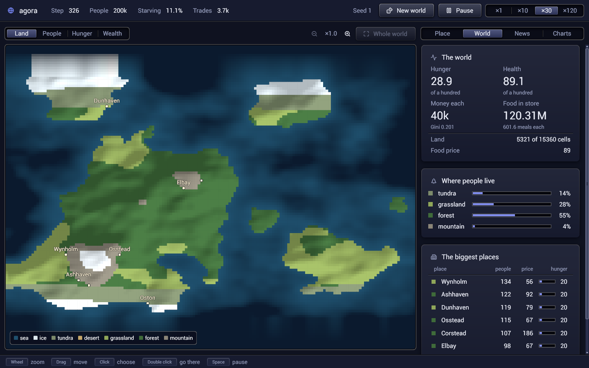
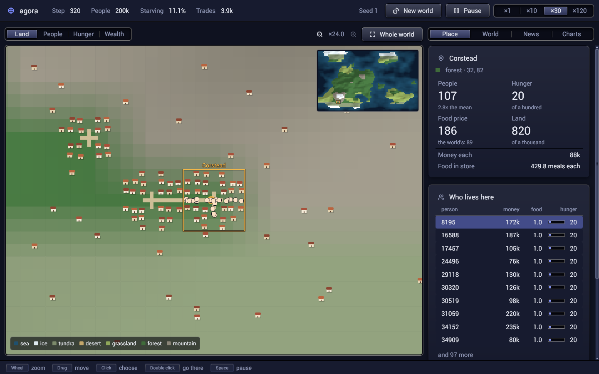

<p align="center"></p>

<h1 align="center">agora</h1>

<p align="center"><b>A living world of autonomous people, watched as it runs.</b></p>

agora simulates a world of people who work, trade, trust, distrust, form groups, draw borders and go to war. Each person
acts from a few motivations: subsistence, security, belonging, status. Their health, hunger, fear and wealth change how
they decide. Nothing else is written in: tribalism, prejudice, business cycles, states and wars emerge, or do not, from
these rules.

The engine runs headless and in real time; sensors measure what emerges; a viewer, in progress, shows the measures live
and never touches the world.

## What runs today (0.3.0)





- **The window**: the world runs beside it in a thread, at 1 to 120 steps a second; the map shows the land (or the
  people, the hunger, the wealth of a cell) from the whole world down to the streets of a town; a sidebar says who lives
  in a place, what the world's figures are, its news and its charts; a dialog founds another world from a seed. The
  world is never read by the window, and a frame costs no step.
- **A deterministic world**: a seed founds the people, and the same seed gives the same run, byte for byte. Randomness is
  a pure function of (seed, step, agent, use), with no shared state.
- **People in columns**: cell, goods, money, hunger, health, skill, in structure-of-arrays; the step visits them five
  times, and the books of every step balance to the unit (`goods_end == goods_start + produced - consumed`, and money is
  only ever moved).
- **Markets by region**: a 4×4 cells market sets a price from its land and moves it with scarcity; buyers and sellers meet
  in a fixed order, and a person sells its surplus or buys food, never both in one step.
- **Sensors**: totals, means and an exact Gini, taken at their own rates and kept in rings; a run with sensors and a run
  without them end in the same state.
- **One command**: `agora run --agents:1000000 --steps:1000 --seed:1` prints the world as it runs, and its steps per
  second (about 30 at a million people, on the processor).

## Build

```sh
git clone --recurse-submodules https://github.com/sachahjkl/agora
cd agora
nix develop
./build.sh
./build/agora                 # the window
./build/agora run --agents:20000 --steps:300   # the engine alone, headless
```

The program is written in [Odin](https://odin-lang.org) on [gui_toolkit](https://github.com/sachahjkl/gui_toolkit).
[docs/development.md](docs/development.md) has the tool (`agoratool`), the tests and the checks; the design and its
decisions are in [src/md](src/md/README.md).

## Licence

MIT. See [LICENSE](LICENSE).
